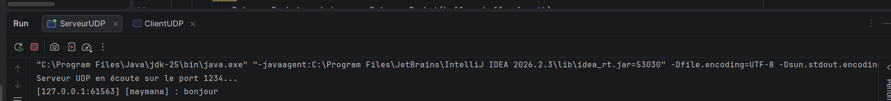
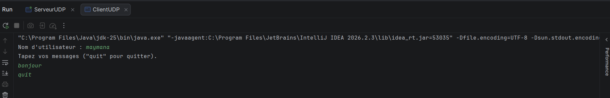
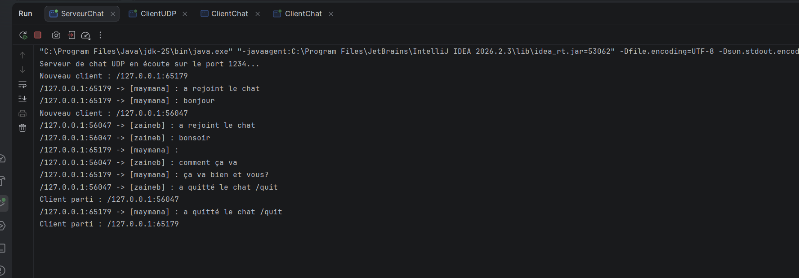
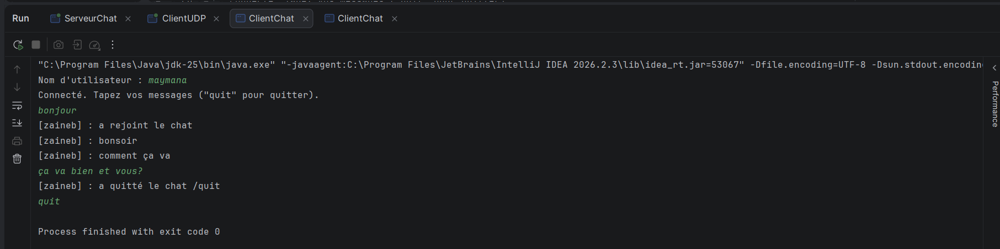

# TP 4 : Sockets en mode non-connecté UDP
## Service de chat Client/Serveur avec UDP

**Matière** : Développement d'applications réparties
**Niveau** : LSI 3 – Faculté des Sciences de Sfax (2026 – 2027)
**Réalisé par** : *Maymana Amara*

---

## 1. Objectifs

- Maîtriser l'échange de données au niveau des datagrammes (`DatagramPacket`) avec les sockets UDP (`DatagramSocket`) en Java.
- Implémenter une application de chat client-serveur en mode non-connecté.
- Gérer l'envoi et la réception asynchrones de messages avec un ou plusieurs clients.

## 2. Environnement

| Outil | Version |
|-------|---------|
| JDK | >= 1.8 |
| IDE | Eclipse / IntelliJ IDEA / VS Code |
| Git | dernière version |

## 3. Structure du projet

```
votreNomPrenom_LSI3_DevAppReparties/
├── etape1/
│   ├── ServeurUDP.java
│   └── ClientUDP.java
├── etape2/
│   ├── ServeurChatUDP.java
│   └── ClientChatUDP.java
├── img/                  
└── README.md
```

---

## 4. Étape 1: Chat unidirectionnel (un seul client)

### Principe

- Le **serveur** lie un `DatagramSocket` au port **1234** via `InetSocketAddress`, attend les datagrammes et affiche l'adresse (IP:port) de l'expéditeur ainsi que le contenu du message.
- Le **client** demande un nom d'utilisateur, lit les messages au clavier et les envoie au serveur sous la forme `[NomUtilisateur] : message`.

### Exécution

```bash
cd etape2_unidirectionnel
javac *.java
java ServeurUDP        # terminal 1
java ClientUDP         # terminal 2
```

### Imprimés écran

| Serveur | Client |
|---------|--------|
|  |  |

### Synthèse

Le client envoie des datagrammes sans établir de connexion préalable. Le serveur les reçoit avec `receive()` et identifie l'expéditeur grâce à l'adresse IP et au port contenus dans le `DatagramPacket`. La communication est ici **unidirectionnelle** : le serveur ne répond pas.

---

## 5. Étape 3 : Chat bidirectionnel et diffusion à plusieurs clients

### Principe

- Le **serveur** maintient un ensemble d'adresses (`SocketAddress`) des clients ayant déjà envoyé un message (simulation de la « connexion »). À chaque message reçu, il enregistre l'expéditeur s'il est nouveau, puis retransmet le message à **tous les autres clients**, sauf l'expéditeur.
- Le **client** utilise deux threads : un pour **envoyer** (lecture clavier) et un pour **recevoir** en continu les messages diffusés par le serveur.
- UDP étant non connecté, le client envoie un premier message à son arrivée afin de s'enregistrer auprès du serveur.

### Exécution

```bash
cd etape3_bidirectionnel
javac *.java
java ServeurChatUDP    # terminal 1
java ClientChatUDP     # terminal 2 (Client 1)
java ClientChatUDP     # terminal 3 (Client 2)
```

### Imprimés écran

**Serveur**



**Client 1**



**Client 2**


### Synthèse

- Le serveur enregistre dynamiquement l'adresse de chaque nouvel expéditeur : il n'y a pas de véritable connexion, l'enregistrement se fait à la réception du premier datagramme.
- Chaque message est retransmis à tous les clients enregistrés **sauf à son expéditeur**.
- L'utilisation de **deux threads** côté client (envoi et réception) permet un échange en temps quasi-réel, car `receive()` est bloquante et ne doit pas empêcher la saisie au clavier.
- **Limites d'UDP** : pas de garantie de livraison, d'ordre ni de détection des doublons ; le serveur ne détecte pas la déconnexion d'un client ; la taille d'un message est limitée par le buffer de réception.

---

## 6. Conclusion

Ce TP a permis de mettre en œuvre la communication en mode non-connecté avec `DatagramSocket` et `DatagramPacket`, d'abord en chat unidirectionnel, puis en chat multi-clients avec diffusion. UDP offre simplicité et rapidité, au prix d'une absence de fiabilité qu'il faudrait gérer au niveau applicatif pour un usage en production.
